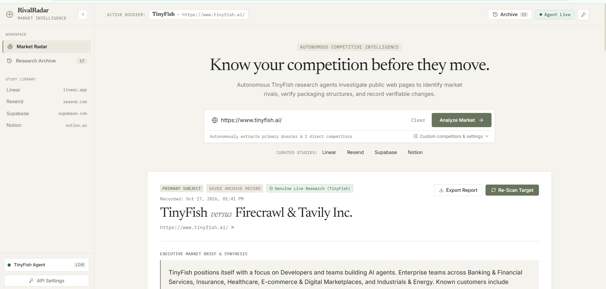
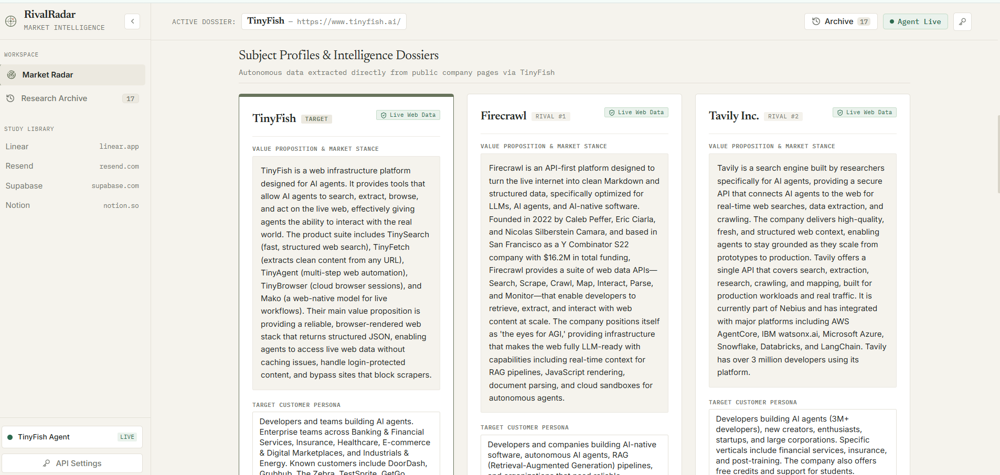

# RivalRadar — Autonomous Competitive Intelligence Platform

> **Editorial Market & Competitive Intelligence powered by TinyFish Web Agents**  
> RivalRadar investigates company web surfaces to identify direct competitors, extract published pricing and capability data from live DOM elements, and track market changes over time.

---

## Overview

RivalRadar provides strategic competitive intelligence for technology teams, founders, and product strategists. Enter any company website; autonomous TinyFish agents explore public web surfaces to discover competitors, extract structured feature and pricing data, and record verifiable changes across observations.

Designed with an **Editorial Intelligence** visual language inspired by premium research publications and strategic consultancies—featuring warm paper tones, Newsreader serif typography, and IBM Plex Mono metadata.

---

## Key Features

1. **Autonomous Competitor Discovery**
   - Automatically uncovers direct market rivals for any company website (e.g. `linear.app` ➔ `Jira Software` & `Shortcut`; `resend.com` ➔ `Mailgun` & `Postmark`).
   - Supports custom competitor overrides when specific targets are desired.

2. **Live DOM Intelligence via TinyFish**
   - Deploys multi-target web research agents via the official TinyFish SDK (`@tiny-fish/sdk`).
   - Extracts structured schema data: `company_name`, `product_summary`, `features`, `pricing`, `target_customers`, `evidence_urls`, and `unknowns`.
   - Cites every visited URL as verifiable evidence.

3. **Editorial Capability Matrix & Pricing Breakdown**
   - Side-by-side feature comparison table with confirmed, not found, and unverified capability states.
   - Financial-table pricing breakdown with verified subscription tiers, billing periods, and direct links to official pricing pages.
   - Core moats, strategic differentiators, and target customer segmentation.

4. **Historical Change Detection & Research Archive**
   - Saves research dossiers as local JSON snapshots on disk.
   - Accurately detects price modifications (with strikethrough comparison), added/dropped capabilities, and target audience shifts.
   - Strict guards prevent missing or unlisted data from being misclassified as dropped features.
   - Dedicated Research Archive ledger allowing instant browsing of previously saved records without triggering new scans.

5. **Multi-Format Export**
   - Export research reports as formatted **Markdown** for executive briefs.
   - Download raw **JSON** data for analytics pipelines and CRM workflows.

6. **Genuine Research vs. Synthetic Demo Fixtures**
   - Genuine TinyFish live scans are tagged with `Genuine Live Research (TinyFish Agent)` and cite live URLs.
   - Synthetic demo fixtures are labeled with `Synthetic Demo Fixture` so demo data is never presented as actual market observations.

---

## 📸 Screenshots

### Market Radar Dashboard
*Editorial market radar overview showing executive summaries, key moats, capability matrix, and pricing breakdown.*



---

### Competitor Intelligence Dossiers
*Three-way competitor dossiers with confirmed capabilities, pricing plans, and verified source evidence URLs.*



---

### Research Archive and Saved Studies
*Editorial ledger of historical studies with instant snapshot restoration and cross-scan change detection.*


---

## Technology Stack

- **Frontend**: React 19, Vite, Tailwind CSS v4, Lucide React
- **Typography**: Newsreader (Editorial Serif), Inter (Sans-serif), IBM Plex Mono (Technical/Metadata)
- **Backend**: Node.js, Express, Server-Sent Events (SSE)
- **Web Research**: TinyFish Autonomous Web Agent SDK (`@tiny-fish/sdk`)
- **Persistence**: Local JSON snapshot storage on disk
- **Testing**: Node.js built-in test runner (`node:test`, `node:assert`)

---

## Project Structure

```
rivalradar/
├── client/                     # Frontend Application (React 19 + Vite + Tailwind v4)
│   ├── src/
│   │   ├── components/
│   │   │   ├── Header.jsx              # Editorial masthead, active dossier context & status
│   │   │   ├── Sidebar.jsx             # Collapsible workspace sidebar with study library
│   │   │   ├── ScanInput.jsx           # Target URL input with validation & custom overrides
│   │   │   ├── LiveScanModal.jsx       # Vertical research timeline with elapsed timer
│   │   │   ├── OverviewCard.jsx        # Executive briefing report with moats & pricing summary
│   │   │   ├── CompanyCards.jsx        # 3-way subject dossiers with evidence URLs & unknowns
│   │   │   ├── FeatureMatrix.jsx       # Capability comparison table with tri-state indicators
│   │   │   ├── PricingComparison.jsx   # Subscription tiers breakdown & pricing links
│   │   │   ├── DiffBanner.jsx          # Historical observation diffs with terracotta accent
│   │   │   ├── SnapshotsDrawer.jsx     # Research Archive ledger with search & diff selector
│   │   │   ├── ApiKeyModal.jsx         # TinyFish API key configuration modal
│   │   │   ├── ExportModal.jsx         # Markdown report copy & JSON file download
│   │   │   └── RadarMark.jsx           # Precision architectural radar symbol
│   │   ├── App.jsx                     # Core application state & layout orchestrator
│   │   └── index.css                   # Editorial Intelligence design tokens & typography
│   └── vite.config.js                  # Vite configuration + API reverse proxy to :3001
│
├── server/                     # Backend API & Research Services (Node Express)
│   ├── data/snapshots/         # Local JSON persistence storage for research records
│   ├── src/
│   │   ├── routes/
│   │   │   ├── health.js               # Service health & API key status
│   │   │   ├── scan.js                 # POST /api/scan & SSE GET /api/scan/stream
│   │   │   ├── snapshots.js            # Snapshots CRUD & comparative diff endpoints
│   │   │   └── testAgent.js            # Agent verification endpoint with SSRF guards
│   │   ├── services/
│   │   │   ├── tinyfish.js             # TinyFish SDK client & JSON schema definitions
│   │   │   ├── analysis.js             # Discovery, extraction pipeline & matrix synthesis
│   │   │   └── storage.js              # Snapshot persistence & change diff algorithm
│   │   └── index.js                    # Express HTTP server
│   ├── test/
│   │   ├── analysis.test.js            # Tests for research pipeline & mock guards
│   │   ├── storage.test.js             # Tests for snapshot diffing & missing data safety
│   │   ├── tinyfish.test.js            # Tests for schema compliance & secret redaction
│   │   └── run-live-scan.js            # Standalone live scan execution script
│   └── .env.example                    # Backend environment variables template
│
├── .env.example                # Root environment template
└── .gitignore                  # Git exclusion rules protecting secrets & build artifacts
```

---

## Getting Started

### 1. Prerequisites
- **Node.js**: version 18.0 or higher
- **npm**: version 9.0 or higher
- **TinyFish API Key**: (Optional for demo mode; required for live web scans). Get one at [agent.tinyfish.ai](https://agent.tinyfish.ai/api-keys).

### 2. Environment Configuration

Copy the example configuration:
```bash
cp server/.env.example server/.env
```

Edit `server/.env`:
```env
# TinyFish API key – get one at https://agent.tinyfish.ai/api-keys
TINYFISH_API_KEY=your_tinyfish_api_key_here

# Server port (default 3001)
PORT=3001
```

*(Note: If no API key is provided, RivalRadar will operate in Demo Mode using cached intelligence datasets.)*

### 3. Installation

Install server dependencies:
```bash
cd server
npm install
```

Install client dependencies:
```bash
cd ../client
npm install
```

### 4. Running Locally

**Terminal 1 — Backend API Server:**
```bash
cd server
npm start
```
*Backend server runs at `http://localhost:3001`*

**Terminal 2 — Frontend Application:**
```bash
cd client
npm run dev
```
*Frontend runs at `http://localhost:5173`*

---

## Validation & Testing

### Running Backend Test Suite
Run the 13 automated tests covering the pipeline, schema validity, snapshot diffing, and secret protection:
```bash
cd server
npm test
```
*Expected: 13 passed, 0 failed.*

### Building Frontend Production Bundle
Validate that the client builds cleanly without compilation warnings:
```bash
cd client
npm run build
```
*Expected: Build succeeds in under 1 second.*

---

## API Reference

| Method | Endpoint | Description |
| :--- | :--- | :--- |
| `GET` | `/api/health` | Health check & TinyFish API key detection status |
| `POST` | `/api/scan` | Runs a multi-target research scan (returns full snapshot & diff) |
| `GET` | `/api/scan/stream` | Server-Sent Events (SSE) stream for real-time progress & telemetry |
| `GET` | `/api/snapshots` | Lists all saved research snapshots |
| `GET` | `/api/snapshots/:id` | Pure read endpoint for retrieving a single snapshot & prior diff |
| `GET` | `/api/snapshots/compare` | Compares any two snapshot IDs (`?id1=...&id2=...`) |
| `DELETE`| `/api/snapshots/:id` | Deletes a saved snapshot from disk |
| `POST` | `/api/settings/key` | Dynamically updates TinyFish API key in runtime environment |

---

## Research Data Integrity & Ethics

- **No Fabricated Data**: Live scans only report features, pricing, and claims explicitly crawled from verified URLs.
- **Truthful Diffing**: Missing or unlisted features are not misclassified as dropped products or price changes.
- **Demo Transparency**: Synthetic seeded history is explicitly labeled as `Synthetic Demo Fixture` with visible disclaimers.
- **Secret Redaction**: API keys are restricted to the server environment and never exposed in client bundles or logs.

---

*Built for the TinyFish Hackathon.*
